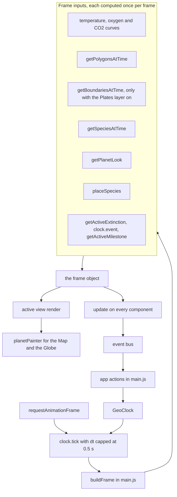
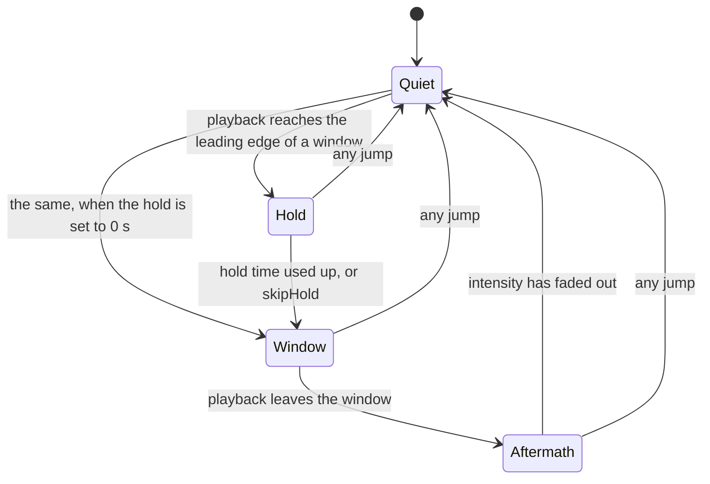

# Architecture

How Life's Tree Blooms turns 4.54 billion years into a few minutes of moving pictures. This page goes deeper than [CLAUDE.md](../CLAUDE.md), which is the short working guide. Field-by-field data formats are in [data-schema.md](data-schema.md), and the evidence behind the numbers is in [data-sources.md](data-sources.md).

The app is vanilla HTML, CSS and ES modules, with no bundler, no framework and no runtime npm dependencies. Three.js v0.170.0 is loaded from jsDelivr through the import map in `index.html`, and only the Globe view uses it.

- [The frame loop](#the-frame-loop)
- [The `app` object](#the-app-object)
- [The `frame` object](#the-frame-object)
- [The event bus](#the-event-bus)
- [Views](#views)
- [Time: the warp and the clock](#time-the-warp-and-the-clock)
- [Extinction staging](#extinction-staging)
- [The continental model](#the-continental-model)
- [Plate boundaries and paleogeography](#plate-boundaries-and-paleogeography)
- [Marker placement](#marker-placement)
- [Planet look and the planet painter](#planet-look-and-the-planet-painter)
- [The Map and the Globe](#the-map-and-the-globe)
- [The Tree](#the-tree)
- [Narration overlays](#narration-overlays)
- [Deep links](#deep-links)
- [Capture mode](#capture-mode)
- [Performance](#performance)
- [Accessibility architecture](#accessibility-architecture)
- [Failure isolation](#failure-isolation)
- [Checking the whole](#checking-the-whole)

## The frame loop

`js/main.js` is the composition root. It creates the clock, the Map view and twelve UI components, plus the keyboard handler, then starts one `requestAnimationFrame` loop. Everything that moves is driven from that loop.



Each animation frame does four things, in order:

1. `clock.tick(dt)` advances geological time, or holds still during an extinction hold. `dt` is the real time since the last frame, capped at 0.5 s (`MAX_FRAME_SEC`), so a tab that wakes from the background does not leap through an era.
2. `buildFrame()` computes everything about the moment exactly once and puts it in one plain object, the frame.
3. `activeView.render(frame.polygons, frame.timeMa, frame.boundaries, frame.atmo, frame)` draws the picture.
4. `component.update(frame)` runs for every UI component, in the order they were created: Toolbar, Controls, Sidebar, ContextCard, ExtinctionOverlay, MilestoneOverlay, SpeciesPopup, SpeciesModal, Legend, Chapters, Help, Intro. The Shortcuts handler is created separately and has no `update`.

Between steps 2 and 3, a change of timeline row is announced to screen readers, in the same batch as anything the components announce on that frame.

Components never hold references to each other. Each receives `app` in its constructor, reads the frame in `update`, and talks to the others through the bus.

## The `app` object

`app` is the constructor argument of every component (`new Component(app)`).

| Member | What it does |
|---|---|
| `clock` | The `GeoClock` (read freely; prefer the methods below for changes, so the rest of the app hears about them) |
| `bus` | The event bus |
| `state` | `{ view, layers: { plates, labels }, hoverId, focusId, reducedMotion, captureMode }`. `view` is `'map'`, `'globe'` or `'tree'` |
| `speciesById` | `Map` of every catalog entry by id |
| `seek(ma, { play })` | Jump the clock, optionally start playing; broadcasts `clock:playing` |
| `play()`, `pause()`, `togglePlay()` | Transport; each broadcasts `clock:playing` |
| `restart()` | Back to 4540 Ma, still playing if it was |
| `setSpeed(x)` | Clamped to 0.25–4×; broadcasts `clock:speed` |
| `setView(mode)` | Switch views (also accepts the old `'2d'` / `'3d'`); returns a promise that resolves once the newest switch request has been carried out |
| `setLayer(name, on)`, `toggleLayer(name)` | `plates` or `labels`; broadcasts `layer:changed` |
| `notice(text, ms = 2600)` | Short status pill at the bottom of the stage (`#view-notice`) |
| `announce(text)` | Polite screen-reader message in `#live-region`; announcements made in the same task are read together |
| `setMotionPreference('reduced' \| 'full' \| null)`, `getMotionPreference()` | The motion override that Help offers; `null` follows the OS setting again |

While the clock is paused, these actions also schedule a URL update (see [Deep links](#deep-links)).

## The `frame` object

`buildFrame()` returns a fresh object every frame. It is the second argument of `component.update(frame)` and the fifth argument of `view.render`.

| Field | Value | Source | Read by |
|---|---|---|---|
| `timeMa` | The moment, in Ma | `clock.currentTimeMa` | Almost everything |
| `fraction` | Position on the warped story axis, 0 = 4540 Ma, 1 = today | `clock.getFraction()` | Timeline, milestone overlay, Tree |
| `nowSec` | The rAF timestamp in seconds: the clock for every real-time animation | `requestAnimationFrame` | Every animated part |
| `dtSec` | Real seconds since the previous frame, at most 0.5 | rAF | Easing in overlays, sidebar, Globe, Tree |
| `playing`, `speed` | Transport state | `clock.playing`, `clock.speedMultiplier` | Timeline, overlays, views |
| `hold` | `{ id, elapsed, duration }` while the clock holds on an extinction, else `null` | `clock.hold` | Timeline (ring on the play button), extinction card, sidebar, context card |
| `atEnd` | The clock is at the present | `clock.atEnd()` | Timeline, finale, sidebar, Tree |
| `jumped` | A discontinuous jump (scrub, seek, nudge, restart) happened since the last frame | `clock.jumps` changed | Views and overlays drop their transitions |
| `period`, `periodChanged` | The timeline row, and whether it differs from the previous frame's | `getPeriodAtTime` | Timeline, context card, toolbar badge; main.js announces the change |
| `polygons` | Render-ready land polygons (see [The continental model](#the-continental-model)) | `getPolygonsAtTime` | Painter, Globe |
| `boundaries` | Plate boundaries, or `null` while the Plates layer is off | `getBoundariesAtTime` | Painter |
| `atmo` | `{ tempC, o2Pct, co2Ppm, sunLon }`; `sunLon` sweeps 360° once a minute | atmosphere curves | Sidebar, Globe (key-light sway) |
| `look` | Every planet color of the moment | `getPlanetLook(timeMa, atmo)` | Painter, Map, Globe |
| `alive` | Entries alive now, each a copy with `currentAbundance`, most abundant first, ties by id | `getSpeciesAtTime` | Map, Globe, Tree, sidebar |
| `positions` | `Map(id → { lon, lat })`: where to draw each marker | `placeSpecies(alive, polygons, timeMa)` | Map, Globe |
| `arrivals`, `departures` | Ids that appeared or vanished since the previous frame; empty after a jump and while time stands still | difference of `alive` | Map, Globe, Tree, sidebar |
| `extinction` | The mass-extinction window the clock is in, with `progress` 0..1, else `null` | `getActiveExtinction` | Sidebar |
| `crisis` | How much crisis to show (below) | `clock.event`, or a static look | Painter, Globe, Tree, extinction card, timeline, milestone overlay, sidebar |
| `milestone` | The active milestone, or `null` | `getActiveMilestone` | Timeline, milestone overlay, Globe (a ping at its place) |
| `layers` | `{ plates, labels }` (the live `app.state.layers`) | `app.state` | Map, Globe |
| `hoverId`, `focusId` | The species under the pointer, and the one in the dialog | `species:hover`, `species:focus` | Map, Globe, Tree, sidebar |
| `view`, `reducedMotion` | Current view; whether motion is reduced | `app.state` | `reducedMotion`: painter, views, sidebar, extinction card |

`frame.crisis` is one envelope for every crisis visual:

- During playback, when the clock is staging an event: `{ extinction, intensity, elapsedSec, phase, progress }`, copied from `clock.event`. `phase` is `'hold'`, `'window'` or `'aftermath'`.
- When the clock sits in a window it did not stage (the viewer scrubbed or deep-linked into it): `phase: 'static'`, `elapsedSec: null`, and `intensity = staticCrisisIntensity(progress) = 0.55 + 0.45 · sin(π · progress)`.
- Otherwise `null`.

Renderers treat `elapsedSec: null` (and reduced motion) as "show the steady state": no flash, no shock wave, just the look of the crisis at that intensity.

## The event bus

`js/engine/bus.js` is a tiny synchronous bus: `bus.on(type, fn)` returns an unsubscribe function, and `bus.emit(type, detail)` calls each handler in turn. A handler that throws is logged and the others still run. This table is built from the actual `emit` and `on` calls in `js/`.

| Event | Detail | Emitted by | Handled by |
|---|---|---|---|
| `app:ready` | `{ direct }`: true for capture mode or a link with `t=` or `play=1` | main.js, after a deep-linked view switch and `play=1` | capture.js (`__captureReady`), intro.js (shows the intro unless `direct`) |
| `clock:playing` | `{ playing }` | main.js, after every play-state change | controls.js |
| `clock:speed` | `{ speed }` | main.js (`app.setSpeed`) | controls.js |
| `clock:hold` | `{ hold }` (object or `null`) | main.js (`clock.onHoldChange`) | controls.js |
| `clock:end` | `{}`: playback *arrived* at the present (not a jump there) | main.js (`clock.onEnd`) | intro.js (finale), milestoneOverlay.js |
| `view:changed` | `{ mode }` | main.js, once a switch completed | main.js (one-time hint), toolbar.js |
| `layer:changed` | `{ name, on }` | main.js | toolbar.js |
| `motion:changed` | `{ reduced, override }` | main.js | help.js |
| `time:seek` | `{ ma, play? }` | sidebar.js (sparkline click, the "Jump to first life" button) | main.js |
| `time:nudge` | `{ seconds }` of 1× playback | controls.js (scrubber keys), shortcuts.js (arrows) | main.js |
| `clock:toggle`, `view:set`, `layer:set`, `ui:announce` | `{}`, `{ mode }`, `{ name, on }`, `{ text }` | nobody at present; components call `app` directly | main.js |
| `species:hover` | `{ id \| null, x, y, source }`; `source` is `'map'`, `'globe'`, `'tree'` or `'sidebar'` | main.js (relaying each view's hover, and `null` on a view switch), sidebar.js | main.js (`state.hoverId`), speciesPopup.js |
| `species:open` | `{ id }` | main.js (relaying view clicks), sidebar.js, extinctionOverlay.js (victim chips), capture.js | speciesModal.js, speciesPopup.js (hides) |
| `species:focus` | `{ id \| null }` while a species is on show in the dialog | speciesModal.js | main.js (`state.focusId`) |
| `panel:toggle` | `{ name, open? }`; `name` is `'legend'`, `'chapters'`, `'help'`, `'sidebar'` or `'intro'` | toolbar.js, shortcuts.js, help.js, intro.js, legend.js, sidebar.js, capture.js | legend.js (`FloatingPanel`, for the legend and chapters), help.js, intro.js, toolbar.js (the narrow-screen drawer) |
| `panel:changed` | `{ name, open }` | legend.js (legend, chapters), help.js, intro.js, toolbar.js (sidebar) | legend.js, milestoneOverlay.js, toolbar.js, capture.js |
| `panel:close-all` | `{}` (Escape) | shortcuts.js, capture.js | help, intro, legend and chapters, sidebar, species dialog, species popup, toolbar |
| `chapter:step` | `{ dir: -1 \| 1 }` | shortcuts.js (`[` `]`), controls.js (skip buttons) | chapters.js |
| `intro:dismiss` | `{}` | intro.js | main.js (one-time view hint) |

The header of `bus.js` also lists `'modal'` and `'timeline'` as `species:hover` sources, which nothing emits today, and leaves `'intro'` out of the `panel:toggle` names.

## Views

All three views share one interface:

```js
new View(vizContainer)        // #viz-container; canvases live in #viz-stage
view.init()                   // attach listeners, show its element
view.render(polygons, timeMa, boundaries, atmo, frame)   // every animation frame
view.resize()                 // called by a ResizeObserver on #viz-container
view.destroy()                // detach listeners, hide its element, keep GPU state for reuse
view.onSpeciesHover(cb)       // cb(species | null, clientX, clientY)
view.onSpeciesClick(cb)       // cb(species)
```

The Map (`js/views/view2d.js`) is constructed at boot. The Globe (`view3d.js`) and the Tree (`viewTree.js`) are imported with `import()` the first time they are asked for, then constructed and kept for the rest of the session. Extras beyond the interface: `View2D.setViewport()` / `getViewport()`, and `ViewTree.tipPosition(id)` / `resetView()`.

Switching follows a "latest request wins" rule:

- Each request gets a sequence number. A burst of synchronous requests collapses onto the last one.
- A download runs outside any queue, so asking for another view meanwhile never waits behind it, and an abandoned download is never shown.
- The swap itself is synchronous: `destroy()` the old view, then `init()` and `resize()` the new one.
- If the module cannot be downloaded (three.js comes from a CDN), the app stays on the view it was showing and says that a reload is needed.
- If the view cannot be constructed (no WebGL, say), the app also stays where it was. If its `init()` throws, the app falls back to the Map. Either way a notice says the view is not available in this browser.
- `view:changed` is broadcast once the switch is complete, and `#app[data-view]` follows.

## Time: the warp and the clock

**The warp** (`js/engine/timeScale.js`). Every row of `js/data/timeline.js` is on screen for

```
seconds = (startMa − endMa) × temporalWeight / TIMING.baseSpeedMaPerSec      (baseSpeedMaPerSec = 15)
```

at 1×. The rows laid end to end form the screen-time axis, `t0 … t1` per row, 351.98 s in all (`formatClock` reads "5:52"). Within a row the mapping is linear, so

```
Ma(p) = startMa − (startMa − endMa) × (p − t0) / (t1 − t0)       for p in [t0, t1]
fraction = p / 351.98
```

`maToScreenSeconds` and `screenSecondsToMa` find the row by binary search. `getSegments()` returns the rows as `{ period, startMa, endMa, t0, t1, f0, f1 }`.

The weights come from editorial targets: weight = target seconds × 15 / duration in Myr, to three significant figures. At 1× that means 36 Ma per second through the Hadean, 2.6 Ma per second through the Cambrian, and about 1,060 years per second through the Holocene. Half the show is over just as the Carboniferous begins, 358.9 million years ago, and the last non-bird dinosaurs die three quarters of the way through (66 Ma sits at 0.747). Screen time per eon or era:

| Unit | Screen time at 1× | Share |
|---|---|---|
| Hadean | 14 s | 4.0% |
| Archean | 32 s | 9.1% |
| Proterozoic | 1:11 | 20.2% |
| Paleozoic | 1:28 | 25.0% |
| Mesozoic | 0:58 | 16.5% |
| Cenozoic | 1:29 | 25.3% |

On top of the 5:52, each of the Big Five adds a 6 s hold and a slowed crossing of its window (about 1.6–2 s instead of 0.5–0.6 s). An uninterrupted play-through at 1× therefore lasts about 6:28.

Anything drawn against time uses this axis: the timeline bands and playhead, every sparkline, and the radius of the Tree. The scrubber is a visually hidden `<input type="range">` in `controls.js` whose maximum is `round(351.98 / TIMING.nudgeSeconds)` = 176, one step per 2 s of playback; its value goes through `fractionToMa(value / max)`. Pointer seeks on the timeline go through `clock.seekFraction(f)`.

**The clock** (`js/engine/clock.js`). `GeoClock` keeps `position`, the playhead in screen seconds, and derives `currentTimeMa` from it. Each tick moves the position by `dt × speed`, times `TIMING.extinctionSlowdown` (0.3) inside a mass-extinction window. Three guards keep it honest:

- Time never runs backwards, even though round trips through the warp are not bit-exact.
- A tick never steps over the leading edge of a window. At 4× a single frame can be longer than the whole K–Pg window, so the clock lands exactly on the edge instead.
- A zero-length frame changes nothing. Recomputing the time from an unchanged position could land one ulp before the edge of the window the clock is in, and would restart its hold.

Other members: `play()` (which rewinds first when at the end), `pause()`, `togglePlay()`, `setSpeed()`, `setTime(ma)`, `seekFraction(f)`, `nudge(seconds)`, `restart()`, `skipHold()`, `atEnd()`, `getFraction()`, `elapsedSeconds()`, `remainingSeconds()`, and `jumps`, a counter bumped by every discontinuous jump. Its callbacks are wired to the bus in main.js: `onPlayingChange` (the clock stopped by itself at the present), `onHoldChange` (`clock:hold`) and `onEnd` (`clock:end`). Non-finite times, fractions, steps and speeds are ignored rather than stored.

## Extinction staging

A mass extinction is staged in three beats, all driven by real time inside `tick()`, with no `setTimeout` to race against the viewer's own control.



- **Hold.** Time freezes on the leading edge for `TIMING.extinctionPauseSeconds` (6 s; capture mode can change it with `hold=`). `clock.hold = { id, elapsed, duration }`. The hold counts only while playing: pausing freezes it. `skipHold()` ends it early: Space while playing, the Continue button on the card, or the play button on the timeline. While the pointer moves over the extinction card, or keyboard focus is inside it, the card winds `hold.elapsed` back by each frame's `dtSec`, so the countdown waits for the reader. This is the one place a component writes clock state.
- **Window.** Time crawls through `timeMa ± durationMa / 2` at 0.3× speed. Each window is sized so that it takes about 1.5–2 s to cross.
- **Aftermath.** Time runs normally again while `event.intensity` eases back to 0 over `TIMING.extinctionAftermathSeconds` (3 s). The fade also completes while paused, so a paused screen settles on what its moment looks like.

`clock.event` is `{ id, extinction, elapsedSec, phase, intensity, aftermathSec, peak }` while an event is staged. Intensity ramps in over 0.7 s with a smoothstep in every phase, so a hold skipped at once does not pop.

Scrubbing never triggers a hold. A jump syncs the edge detector silently and clears `clock.event`, and a window you land in shows its static look (`frame.crisis.phase === 'static'`). If playback then leaves that window, the clock starts an aftermath with `elapsedSec: null` and `peak` set to the static intensity of the last frame inside the window, so the look fades out instead of being cut.

## The continental model

`js/engine/interpolator.js` turns `js/data/continents.js` into the land of any moment through one function, `getPolygonsAtTime(timeMa)`. Behind it are two regimes and a hand-over between them. The data file's header documents the formats in full.

**Rigid plates, 0–540 Ma.** 31 plates and blocks carry real coastlines: Natural Earth 1:110m land, simplified to 126 rings with 2,981 vertices. A plate never changes shape. Its position at any time is its present-day outline turned on the sphere by a pose:

- Poses are keyframes in a plate's `track`, at 60 distinct times between 0 and 540 Ma. A keyframe is either `[Ma, lon, lat, spin]` (where the plate's anchor point was, and how far it had turned) or `[Ma, { pole, angle }]` (a finite Euler rotation, the form of published reconstructions). The rows up to 66 Ma were tuned by hand; those from 80 Ma back are sampled from the full-plate model of Merdith et al. (2021).
- Between keyframes the pose is a quaternion slerp: one steady rotation about a fixed stage pole, so nothing jumps at a keyframe. Plates that are welded together share keyframe times and so stay locked together in between.
- 26 of the 31 plates have a `parent` (Siberia hangs off Eurasia, Australia off Antarctica …). The world pose is parent pose ∘ own pose, and a parent's id also covers its children: `plateToWorld('eurasia', …)` for a point in Siberia follows Siberia.
- The kinematic range, `getKinematicRangeMa()`, is the oldest time for which every plate has a keyframe: 540 Ma.
- Rings carry labeling hints. Five label groups (Asia, Europe, North America, Great Britain, Ireland) give their pieces one shared name while they are together. `oldName` renames a ring further back (North America is Laurentia before 420 Ma). Island labels fade out between 66 and 120 Ma. `emerge: [fromMa, toMa]` grows land that did not exist earlier (Panama, Iceland, Japan, accreted terranes) out of a point.

**Deep time, 570–4400 Ma.** Eleven slices of schematic paleocontinents (570, 600, 750, 900, 1100, 1300, 1600, 2200, 2700, 3100 and 4000 Ma, with 3 to 10 continents each) morph from slice to slice. Each morph between two slices is planned once, as a "stage plan":

- Continents are matched by id, then by their `from` / `into` hints, then by distance.
- A parent that splits is partitioned among its children with power-diagram cells, so the pieces tile the parent at the moment of the split; a merge is the same run backwards. Nothing ever collapses to a point.
- The two outlines of each track are aligned by a best-fit rigid rotation and cyclic shift, then resampled onto one shared vertex list.
- Every frame then only blends vertices in the co-moving frame and applies part of the rigid rotation, eased with short run-ups at both ends. A continent that merely drifts keeps its shape, and one that changes shape does so without tumbling.

Between 4400 Ma (`FIRST_CRUST_MA`) and the oldest slice, that slice's continents grow from nothing. Before 4400 Ma there is no land.

**The hand-over, 570 → 540 Ma**, is an ordinary deep-time morph whose younger end is the plates themselves. The plates coast up to 9 Ma past their oldest keyframe, so position and velocity are both continuous at the switch. A plate leaving a schematic continent keeps its bearing, and drifts along the parallels rather than swinging past a pole.

**Output.** `getPolygonsAtTime` returns render-ready polygons: `{ id, name, color, vertices, labelAt, labelRank, bbox, plateId?, label? }`.

- Vertices are dense. They stay within ±180° and ±90°: a ring that crosses the antimeridian is cut there, and a ring around a pole is closed along the ±90° edge. Edges on that frame are seams (`geo.isSeamEdge`), which renderers fill across but never stroke.
- `labelRank` is about √area in degrees (Africa ≈ 49, Great Britain ≈ 4); 0 means do not label.
- Today there are 127 polygons with 2,989 vertices; at 900 Ma, 12 polygons with 1,912. The validator's busiest frame has 3,518 vertices, against a budget of about 4,500.

**Riding a plate.** `plateToWorld(plateId, lon, lat, timeMa)` answers "where was this present-day point then?". The species markers, the extinction epicenters, milestone places, the paleogeography catalog and the plate boundaries all go through it.

- Inside the rigid range it is the exact paleo-position.
- Further back the point rides the plate's track through the hand-over, then the continents the plate descends from, slice by slice (`deepPath`). Each step of that path stores where the site is at the stage's younger end (`x`) and at its older end (`xa`). At the hand-over a site follows the plate's main ring that contains it, or else the nearest main ring. A site on an island ring is therefore carried as an offshore site of the mainland: Mistaken Point, on Newfoundland, sits 3.7° out to sea at 570 Ma.
- `xa` comes from `carryBack()`. The site's mean value coordinates with respect to the younger outline are applied to the older outline (the two share one vertex list), so the site keeps its place in the shape as the shape changes. Turning it rigidly with the outline's best-fit rotation instead would let it drift tens of degrees off its land by the Archean. Where an outline does not change, the site does not move.
- A site that was on land and would land outside the older outline is tucked back in (`tuckInto`): across the nearest coast and up to 2.5° inland, less where the land is narrower, or else to the outline's inner point. A site that started offshore may end up at most 2° further offshore before it is tucked in, so offshore sites stay roughly as far offshore.
- Between two slices `plateToWorld` blends from `xa` to `x` with the same easing as an outline vertex, then applies the track's rotation, so a site never jumps at a slice boundary. Across ±0.001 Myr the largest step for any species or event site is 0.004° (at 540 Ma), and 0 at every older slice. Before the oldest slice a site shrinks toward the nucleus of its continent, with the land.
- Where a merge offers several parents, a site normally follows the parent whose piece of the merged outline it lies in, which is a matter of geometry rather than geology. `cratonLineages` in continents.js overrides that for three regions. Each is a generous present-day circle with a list of deep-time continents, young to old: `kaapvaal` (kalahari → ur → vaalbara), `west_australia`, the Pilbara and Yilgarn cratons (ur → vaalbara), and `congo` (west_gondwana → congo). A site inside a circle follows the listed parent, or the oldest-listed if several are offered. One stage earlier it is moved into that parent's piece while the continent is still whole, so it crosses on land. Pongola at 2,950 Ma and Pilbara at 3,480 Ma therefore sit on Vaalbara, Franceville at 2,100 Ma sits on the Congo craton, and Isua stays on land.
- `findPlateAt(lon, lat)` is the inverse question for today: which plate a present-day point sits on, with up to 4° of offshore slack.

## Plate boundaries and paleogeography

**Plate boundaries.** `getBoundariesAtTime(timeMa)` in `js/engine/plateBoundaryInterpolator.js` returns open polylines:

```js
[{ id, type: 'divergent' | 'convergent' | 'transform', vertices: [[lon, lat], …], name?, opacity? }]
```

`js/data/plateBoundaries.js` describes each of its 75 boundaries once: its type, its lifespan, an optional name (or a schedule of names), and how it moves.

- **One plate.** It turns with that plate, or with the block under each vertex.
- **Two plates.** It is drawn part-way between two copies carried by both plates: a ridge in the middle of its ocean, a trench just off the overriding plate, a suture on the seam.
- **Fixed.** It stays in map coordinates, for open-ocean lines with no continent to hold on to.

A carrier's pose is recovered from two probe points that `plateToWorld` carries. In the rigid range that is exactly the plate's rotation. Before 540 Ma it is how that part of the schematic continent turns as the continent changes shape, so a deep-time line follows its craton instead of contradicting the drawn geography. An entry's `at` point picks the carrier, and because it rides `plateToWorld`'s lineage, the `at` points need re-checking whenever the craton lineages change.

- Birth and death are drawn as growth, with `opacity` for the share drawn; conjectural Archean lines are fainter.
- Lines are densified to edges of at most 3°, cut at the antimeridian (pieces `<id>~1`, `<id>~2` …) and memoized per time.
- A boundary's name sits on its longest piece only. Convergent lines keep the overriding plate on their left, and the painter puts its teeth on that side.
- There are no boundaries before `TECTONICS_START_MA` (3200 Ma). The busiest moment, in the late Cenozoic, has 45 lines and about 690 vertices.

main.js asks for boundaries only while the Plates layer is on.

**Paleogeography.** `js/data/paleogeography.js` holds the names and events of every moment: 27 ocean names, 18 land names, 90 features and 21 migration routes, in four tables (`OCEANS`, `LANDS`, `FEATURES`, `ROUTES`), plus 64 generated tracks. Four accessors return what is visible at a given time; `paleoData` exposes the tables and tracks (read-only by convention) for tools and tests.

| Accessor | Returns |
|---|---|
| `getOceanLabelsAt(ma)` | `[{ id, name, lon, lat, size, opacity }]`. Size 3 is a superocean, 2 an ocean, 1 a sea or strait. At most 7 at once, at least 12° apart, always over open water while visible |
| `getLandLabelsAt(ma)` | `[{ id, name, subtitle?, lon, lat, size, opacity }]`: names that are not one polygon's own (supercontinents, paleocontinents, terranes of several blocks, old names with a "future …" subtitle). A label whose id or name matches a polygon's stands in for that polygon's own label. Always on land |
| `getFeaturesAt(ma)` | `[{ id, type, kind?, name, lon, lat, radiusDeg, intensity, opacity, phase, description, startMa, endMa, path?, ends? }]`. `type` is `lip` (25 of them), `impact` (22), `orogeny` (18), `gateway` (20) or `other` (5). `intensity` rises, holds and dies away; an impact flashes and then leaves a scar. `phase` is `active` or `waning` (`impact` or `scar` for impacts). Mountain belts give a `path`, gateways their two shores in `ends`. At most 8 at once: the most visible and intense are kept |
| `getMigrationsAt(ma)` | `[{ id, name, group, color, path, route, progress, opacity, description, startMa, endMa, speciesIds? }]`. `group` is `sapiens` (10 routes), `archaic` (4) or `fauna` (7). `path` is the part already traveled, its last point the head; `route` is the whole journey; `progress` is the share traveled. A finished route marked `persist` (all ten of our own species' routes) stays on the map, faintly, to the present; the others fade away |

How it behaves:
- **Positions.** Every coordinate returned is already in the map frame of that moment. No item carries a `plateId`, so consumers draw what they get.
- **Results** are memoized per time and frozen. NaN or negative times count as the present, and nothing throws. Over a whole play-through in Node, the four accessors together cost about 13 µs per frame on average; the first call takes about 3 ms.
- **Places in the tables** are `['plate', lon, lat]` (a present-day point that rides its plate through `plateToWorld`), a fixed `[lon, lat]`, or a track of keyframes.
- **Generated tracks.** Ocean names, land names of landmasses that are not one rigid plate, features older than 540 Ma or in the open ocean, and the points of deep-time mountain belts all follow generated tracks: map-frame keyframes fitted once against the continents by an offline script. Nothing here carries a point beyond 540 Ma at runtime.
- **Timing is in screen seconds**, not Ma. A label fades in and out over 1.2 s, a feature stays on screen for at least 4 s, and an impact appears at once and flashes for about 0.7 s.
- **Nothing teleports.** A track step faster than 6° per Ma that covers more than 3° counts as a jump: the item fades out before it and back in after it.

Who consumes it:
- The painter draws ocean names, land names (dropping a polygon's own name when a land label stands in for it), feature symbols with their names, and routes.
- The Globe reads the ocean and land labels for its HTML name overlay and places them as given.
- The validator checks the item shapes (an ERROR when broken). It also checks placement at 1,097 moments, with warnings for ocean names over land or closer than 12°, land names and land features at sea (gateways and marine features may sit at sea), and more than 7 ocean names or 8 features at once.

<!-- REVIEW after final-review fixes -->

The painter currently cuts a route's `path` again by `progress`, so a route under way is drawn shorter than the distance it has traveled. A fix is queued.

## Marker placement

A species' `location` is a modern fossil locality, but the land under it is paleogeography. `placeSpecies(alive, polygons, timeMa)` in `js/engine/geo.js` reconciles the two for every frame and returns `frame.positions`. Views draw markers there, never at `sp.location`. For each living entry it runs four steps:

1. **Anchor.** Entries whose sites lie within 1.5° of each other (with the same habitat) form one cluster. The cluster finds its plate once with `findPlateAt`, and rides it with `plateToWorld`: exactly in the rigid range, and through the deep-time morphs further back (see [Riding a plate](#the-continental-model)), so a marker starts its search close to the land it belongs to.
2. **Settle.** Marine entries go into the sea just off the nearest shore, at least 1.6° out. Most marine fossil sites are on land today, and they belong on the adjacent shelf. A marine site that rides a plate stays within 1.6° + 2.4° of that shore. Every other habitat goes on land, about 0.9° inside the nearest shore where there is room. `inferHabitat(sp)` uses `sp.habitat`, or guesses from the category for older data.
3. **De-cluster.** Species that share a site spread into a hexagonal cluster 2.8° apart. Each species owns a fixed slot, worked out once from the whole catalog, oldest inhabitant at the center, so arrivals and extinctions never shuffle the others. Near a shore the cluster fans away from it. A slot that lands on the wrong surface settles on its own.
4. **Smooth.** A marker never teleports. When its proper place changes abruptly (a strait closes, another shore becomes the nearest), it glides there at a limited speed over the next frames.

During continuous playback (steps of at most 3 Ma) a marker stays loyal to the stretch of shore it used on the previous frame, so it does not flicker between two candidate coasts. After a jump everything is decided afresh, so scrubbing to a moment always shows the same picture. The shore search runs on the sphere against a per-moment index of the coastlines, built in chunks of 12 edges, each with its own bounding ball. A call with the same polygons, the same living ids and the same time returns the previous result, unless a glide is still under way.

## Planet look and the planet painter

**`getPlanetLook(timeMa, atmo)`** (`js/util/planetLook.js`) is the planet's color story.

- Art direction picks the colors; the data picks the timing. Magma follows `getMagmaFraction`, the sea color follows the ocean-chemistry regimes, the land greens with `getVegetation` and grass spreads with `getGrasslandFraction`. Ice sits where `getGlaciation` puts it, and the climate belts slide with the temperature curve.
- It returns `ocean { shallow, deep, abyss }`, `shelf` and `shelfWidth`, `landStops` (land color every 5° of latitude), `rock`, `coast`, `wet` / `dry` tints with their latitude stops, `ice { … }`, `atmosphere { rim, rimAlpha, tint, tintAlpha }`, `magma` with `magmaRamp`, `water`, `vegetation` and `space`.
- Climate inputs are averaged over a third of a second of playback on either side, so even a step in a data curve becomes a short ramp. The result is memoized per moment.

**`js/views/planetPainter.js`** paints the planet's surface for one frame onto a 2D canvas. The Map and the Globe share it, so the two views always show the same world. A view describes itself in a `view` object: `{ projection, scale, cx, cy, width, height, pixelRatio, outline, layers: { graticule, labels, features, boundaries }, zoom?, avoid? }`.

- **The Map** uses Equal Earth with `outline: true`. The painting is clipped to the planet's outline and gets an outer halo and a limb glow. Labels and features follow the Labels layer; boundaries are on whenever `frame.boundaries` is present. `avoid` lists the marker labels, which place names keep clear of.
- **The Globe** uses equirectangular with `outline: false`, which fills the whole texture. Labels are off, because the Globe sets its own names in HTML. Features follow the Labels layer and boundaries the Plates layer.

The layers, bottom to top, in the order `paintPlanet` calls them:

| Layer | Notes |
|---|---|
| Outer halo | Map only, then everything below is clipped to the planet's outline |
| Ocean | `look.ocean`, lightest at the equator and darkest toward the poles |
| Magma fissures | While the magma ocean lasts, glowing along the `magmaRamp` |
| Graticule | |
| Shelf-sea glow | `look.shelf`, as wide as `look.shelfWidth` |
| Anoxia stain | Only during a crisis whose mechanism is `'anoxia'` |
| Sea ice | |
| Land | Drop shadow and coastline first, then one latitude gradient for every continent, then (clipped to the land) rain and drought tones, a hillshade that rides with each plate, rim light on north-west shores and shade on south-east ones, and the ice sheets |
| Hot spots | Glowing magma vents, while the magma ocean lasts |
| Plate boundaries | Divergent dashed, convergent solid with teeth, transform dotted, in `COLORS.boundary` colors |
| Paleogeographic features | Eruptions, impacts, mountain belts, gateways, migration routes |
| Crisis effects | By `extinction.mechanism` (`impact`, `volcanism`, `glaciation`, `anoxia`), centered on the epicenter carried back with `plateToWorld` |
| Scene tint | `look.atmosphere.tint` |
| Place names | Ocean names, landmass names, each polygon's own name, feature and boundary names; placed greedily by priority, clear of each other and of the `avoid` boxes, sea names kept at sea |
| Limb glow | Map only |
| Asteroid streak | Map only, drawn outside the clip for an impact's first second |

During a crisis the look itself also leans toward a dark version of the event's color, by up to 25% at full intensity.

**How it stays fast.**
- Coastlines are projected once per moment into `Path2D` objects, in projection units, so panning and zooming reuse them.
- Everything soft (shelf glow, rain shadows, rim light) comes from one small blurred land mask per moment instead of wide strokes.
- Relief is a tiling hillshade, and helper canvases are software-backed so nothing is read back from the GPU.
- `paintKey(frame, view)` is a signature of the picture that `paintPlanet` would produce. While it is unchanged, the last painting is still correct. Ambient motion is quantized: crisis staging, magma and features in motion repaint every frame, slow ice drift four times a second, and a still planet never.

`paintPlanet(ctx, frame, view)` returns `{ labelBoxes, animated }`.

<!-- REVIEW after final-review fixes -->

The painter's return value is gaining `names: [{ text, lon, lat, kind: 'ocean' | 'land' | 'feature' | 'route' | 'boundary', opacity }]`: the names it chose for this moment. The Globe will show a few of them as HTML labels instead of reading the paleogeography lists itself. Today the Globe still reads `getOceanLabelsAt` and `getLandLabelsAt` directly and places the names at their `lon`/`lat`. That is correct, because every coordinate the module returns is already in the map frame of its moment.

Species markers are not part of the painting. Each view draws its own with `js/views/glyphs.js`, which holds one shape per life group (`dot`, `leaf`, `star`, `hex`, `oval`, `triangle`, `square`, `ring`), so that color is never the only cue.

## The Map and the Globe

**The Map** (`view2d.js`) fits the planet into the stage and handles pan and zoom from 1× to 8× (drag, wheel, pinch, double-click, the HUD buttons). It lays out markers and their labels first, so the place names can keep clear of them, then paints the planet.

- **Caching.** When the paint key is the same for two frames running, the painting moves into an offscreen bitmap and is blitted from then on; `stats.paintMs` reports the cost of the last frame. Only the markers are redrawn every frame.
- **Markers.** A glyph's radius is 4 + 4 · abundance^0.7 px (×0.86 on small screens). Markers breathe by ±6% unless motion is reduced, and the hovered or focused one gets a ring.
- **Arrivals and departures.** A new species blooms with its name for 2.6 s, and a vanished one leaves a gray ember for 1.6 s.

**The Globe** (`view3d.js`) is one lit, textured three.js sphere. Its surface is not geometry: the painter draws the equirectangular planet into an offscreen canvas that is the sphere's color texture. The poles and the antimeridian therefore need no special cases, and no mesh is ever rebuilt.

- **Texture.** It is 1,024, 2,048 or 4,096 texels wide, chosen by zoom, and at most 2,048 while time is moving. After the picture has stood still for 0.3 s it is repainted sharper.
- **Quality governor.** A frame slower than 34 ms, or texture painting that averages over 10 ms, counts as strained. After 90 strained painted frames the quality steps down.
- **Scene.** A key light is fixed to the camera, so the face you look at is lit; it sways slowly with `atmo.sunLon`. An atmosphere shell (radius 1.22) glows in `look.atmosphere.rim`, and the starfield is static.
- **Markers** are pooled screen-size sprites of the same glyphs, sitting exactly on the surface: any altitude would push coastal species out to sea by parallax.
- **Names** are an HTML overlay of 24 pooled slots: at most 9 species names and 11 place names. A new name fades in only after being wanted on two layout passes running, so nothing flickers, unless it answers the viewer directly (hover, the dialog).
- **Camera.** It auto-rotates at 1.6° per second, resuming 4 s after the last interaction. It turns to frame an extinction's epicenter, and turns a species hovered elsewhere (sidebar, Tree) into view. A bolide flies in for an impact, and a ring pings a milestone's place.

The Globe's constructor throws when WebGL is unavailable. main.js turns that into a notice, and the app stays on the view it was showing.

## The Tree

`viewTree.js` draws a radial, time-calibrated tree of life that grows outward as time plays.

- **Radius is time** on the warped axis: the center is the formation of the Earth, and the rim is always "now". The rim therefore moves outward at a steady pace during playback, and nothing beyond it is drawn. Every entry alive at the moment ends in its glyph on the rim; an extinct one ends where it died, with a seed-head.
- **The layout is static**, computed once when the module loads (`buildLayout`, exported as `TREE_LAYOUT`). `js/data/phylogeny.js` lists clades in pre-order, siblings in branching order with the oldest split first, and each clade is a lineage that leaves its parent's at `originMa`. Along a lineage its children (child clades and its own species) peel off one after another at their own dates. After every split the lineage carries on at the middle of the tips still to come.
- **The fan.** The 206 tips are spread evenly over a 330° fan in file order, with a little extra space between life groups, so relatives sit together and the fan ends with the line to humans. Because the oldest branch always leaves from the outside of what remains, no two branches ever cross. The layout holds 174 clade nodes and 572 branch segments (an arc from the parent's angle, then a ray outward). An entry without a known clade is hung on a fallback clade for its category.
- **The camera** frames the now-ring rather than the whole disc. While the tree is small the view is magnified, easing back to the full disc as it grows (`frameRadius(f) = 0.42 · (1 − e^(−f / 0.012)) + 0.58 · f` of the full radius). User zoom (0.7–14×) and pan apply on top.
- **Names** are placed a few times a second (at most every 240 ms during growth, at once on interaction) against an occupancy grid of branches, words and the chrome floating over the stage. In order: the living, outside the rim and most abundant first; the time axis (eras, extinction rings, dates); landmark clades (`LANDMARK_CLADES`); and the extinct ("† Stegosaurus"), mostly once you zoom in.
- **Repaints** are skipped entirely when a signature of the picture is unchanged and nothing is fading or bursting. The Map's Labels layer does not apply here.

## Narration overlays

Four DOM components tell the story over the stage, all styled in `css/overlays.css`.

- **The context card** (`contextCard.js`) answers "where and when am I?": the period, the age in plain words, the moment on a 24-hour Earth clock (`earthClock`: midnight is 4540 Ma), and short lines on life, climate and geography that unfold while paused and for a few seconds after each period change.
- **The milestone layer** (`milestoneOverlay.js`) shows toasts with a guaranteed reading time in real seconds, queued in story order and thinned to the headlines at high speed. It also shows an era title card when playback crosses into a new eon or era.
- **The extinction card** (`extinctionOverlay.js`) explains the catastrophe being staged and lists its victims. It also shakes the stage (never the card) for the first two seconds, except under reduced motion or while paused.
- **The intro and finale** (`intro.js`) are the story's covers.

They keep out of each other's way through flags on `<html>`: `data-ov-crisis`, `data-ov-finale`, `data-ov-intro` and `data-ov-narrating`. The yielding rules live in one place, overlays.css. An era card never plays over a mass extinction, a mass extinction silences the toasts until its card has gone, and the finale lets the last toast finish.

## Deep links

`js/engine/urlState.js` reads `?t=` (Ma) `&view=` `&plates=` `&labels=` `&speed=` `&play=1` at boot. A bare `?plates` turns a layer on, and `0`, `false`, `off` or `no` turn it off. While the clock is paused, the URL is rewritten with `history.replaceState`, debounced by 400 ms.

- The time is written as the shortest tidy decimal that reopens on the same period, extinction and milestone. A link written during the end-Permian hold must not round to 252.2, which lies before the window.
- Parameters the page was opened with that are not ours are kept, after ours.
- The title becomes, for example, "Cretaceous · 66 Ma — Life's Tree Blooms".
- Nothing is rewritten while playing or in capture mode.

## Capture mode

`?capture=1` (`js/capture.js`) hides the chrome and exposes `window.__capture`, so a headless browser can drive the app deterministically. The capture pipeline in `scripts/capture/` and the smoke test both use it.

- `&panel=` is `clean` (the visualization alone), `sidebar` (plus the life-and-planet panel), `clock` (plus the context card) or `full` (both).
- `&hold=<seconds>` overrides the extinction hold.
- Body classes `capture-mode`, `capture-mode-with-sidebar`, `capture-mode-with-clock`, `capture-show-<panel>` and `capture-sweeping` drive the CSS.
- `window.__captureReady` turns true, and `__capture.ready` resolves, on `app:ready`, so no script starts before a deep-linked view and `play=1` have landed.

| Method | |
|---|---|
| `ready` | Promise resolved at boot |
| `setView(mode)` | `'map'`, `'globe'` or `'tree'`; resolves once the view is live, rejects if it did not come up |
| `setTime(ma)`, `seekFraction(f)`, `fractionOf(ma)` | Jump; and the story-axis position of a time |
| `setSpeed(x)`, `play()`, `pause()` | Transport |
| `playUntil(ma, { timeoutMs, aftermath })` | Play until the clock reaches `ma` and any aftermath has faded, then pause on that frame; resolves `{ reason, events, state }` |
| `sweep(fromMa, toMa, durationMs)` | A time-lapse: one seek per frame, evenly along the story axis, stepping over extinction windows |
| `setLayer(name, on)`, `setBoundaries(on)` | Layers |
| `setHoldSeconds(s)`, `skipHold()` | Holds |
| `openSpeciesModal(id)`, `closeSpeciesModal()` | The species dialog |
| `openPanel(name)`, `closePanel(name)` | Legend, chapters, sidebar (Help declines to open in capture mode) |
| `state()` | `{ timeMa, fraction, playing, holding, hold, event, extinctionId, atEnd, speed, view, layers, focusId, holdSeconds }` |
| `waitFor(fn, timeoutMs)`, `sleep(ms)` | Helpers that run on animation frames |
| `activeCanvas()`, `activeView()` | The canvas the active view draws into, and the view itself |

Methods throw (async ones reject) on input they cannot honor, so a script fails loudly instead of filming the wrong scene. The pipeline itself (a DevTools screencast of the whole page fed to ffmpeg, the catalog, the flags) is documented in [capture.md](capture.md) and [scripts/capture/README.md](../scripts/capture/README.md).

## Performance

The target is 60 fps on a laptop, 16.7 ms per frame for everything.

**Measured.**
- The smoke test's informational checks played 4 s from 100 Ma in headless Chromium on the development machine. The app's own script time per frame averaged 4.9 ms on the Map (p95 5.7 ms), 5.2 ms on the Globe (p95 5.8 ms) and 1.9 ms on the Tree (p95 2.8 ms).
- In Node, simulating a whole 1× play-through at 60 fps (21,119 frames), the frame inputs cost 0.79 ms on average (p95 1.5 ms, p99 3.2 ms, worst 6.5 ms). Most of that is `placeSpecies` (0.63 ms on average); `getPolygonsAtTime` costs 0.12 ms on average and up to ~5 ms on deep-time morph frames.

**What is cached.**

| Where | What |
|---|---|
| `getPolygonsAtTime` | The last result (the same time returns the same array). Stage plans and deep-time nodes are built once, on first need: about 0.1 s for all of them in Node, the hand-over plan alone ~17 ms. In a browser they are also prepared one at a time while the page is idle, so playback never stalls on one |
| `plateToWorld` | A site's deep-time lineage through those plans is built on its first call beyond 540 Ma (about 0.3 ms on average, at most ~1 ms once the plans exist) and cached; later calls cost microseconds |
| `getBoundariesAtTime` | The boundary table is compiled on the first call (12–15 ms in Node here), then the result is memoized per time |
| Paleogeography | Every accessor memoized per time, results frozen; deep-time positions are pre-generated tracks, so no lineage is ever built for them at runtime |
| `placeSpecies` | Cluster slots are worked out once for the whole catalog, along with a coastline index per polygon set. The previous result comes back when nothing changed |
| `getPlanetLook` | Memoized per moment |
| Painter | Projected coastlines per moment and projection, one blurred land mask per moment, hillshade tiles, patterns, measured text widths; `paintKey` says when a painting is still valid |
| Map | An offscreen bitmap of the planet while the paint key holds; pooled marker records |
| Globe | The texture is repainted only when its key changes; glyph textures (up to 480), label slots and marker sprites are pooled |
| Tree | The whole layout, built at module load; label placement at most every 240 ms during growth; repaint skipped on an unchanged signature; its canvas's `aria-label` refreshed at most every 1.5 s while playing |
| Sidebar | DOM writes throttled to `TIMING.sidebarUpdateIntervalMs` (100 ms) and made only when the formatted text changed. Rows are keyed by id and never rebuilt (reordering is a FLIP animation). The Index tab is built the first time it is opened |
| Sparklines | Each curve is rasterized once per size into a "past" and a "future" layer. A repaint is two `drawImage` calls and a dot, made only when the playhead moved at least 0.5 px |

**Budgets in code.**
- At most ~4,500 continent vertices per frame (the validator warns; the busiest frame has 3,518).
- At most ~45 boundary lines and ~900 boundary vertices on screen.
- The Globe's governor holds texture painting to about 10 ms per frame.
- No component allocates large objects or rebuilds DOM every frame.

## Accessibility architecture

The user-facing details (the full key map, focus order, what is announced, known gaps) are in [accessibility.md](accessibility.md). This section covers how the pieces fit together.

**Keyboard.** `js/ui/shortcuts.js` is the single global `keydown` handler, and `SHORTCUTS` is the list the Help dialog renders:

| Keys | Action |
|---|---|
| Space | Play / pause (also continues past an extinction hold) |
| ← → | Step back / forward through time |
| Shift + ←/→ | Step five times further |
| PgUp PgDn | Previous / next period (timeline focused) |
| [ ] | Previous / next chapter |
| - + | Slower / faster |
| Home, R | Back to the beginning |
| End | Jump to the present |
| 1 2 3 | Map, Globe, Tree view |
| P | Plate boundaries (Map and Globe) |
| L | Place names & events (Map and Globe) |
| C | Chapters |
| G | Legend |
| ? | This help |
| Tab | Reach the timeline: its event markers are one stop — ← → move between them, Enter jumps |
| Esc | Close the open panel or dialog |

<!-- The PgUp/PgDn row is copied from SHORTCUTS as it stands. In the code (controls.js, the scrubber's key handler) Page Up moves to the next, later period and Page Down back to the start of this or the previous one. Reported; reconcile once the label is fixed. -->

The handler's rules:

- **When it stands aside.** It ignores keys while a modal dialog is open, while focus is in a text field or a select, and with Ctrl, Alt or Meta held (except `[` and `]` typed with AltGr or Option).
- **What controls keep.** Range inputs and radios keep their arrow keys, and buttons keep Space.
- **Escape** emits `panel:close-all` from anywhere, except from a text field that still holds text.
- **Repeat.** Only the arrow keys repeat when held.
- **Component keys.** PgUp/PgDn, Home and End on the scrubber live in `controls.js`, and the timeline's event markers form one tab stop with a roving tabindex.

**Focus.**
- `ModalShell` (exported by `speciesModal.js` and reused by Help) wraps a native modal `<dialog>`. The rest of the page is inert, Escape and a click on the backdrop close it, Tab cycles inside, and focus returns to whatever opened it.
- The intro card is its own `role="dialog"` with `aria-modal`, which it drops at once when dismissed.
- The legend and chapters panels (`FloatingPanel` in `legend.js`) hand focus back to where it was when they close. If nothing had it, they leave nothing focused, so Space is play/pause again.
- The narrow-screen drawer is `inert` while closed.
- A skip link jumps to the timeline.

**Announcements.**
- `#live-region` is polite and atomic. `app.announce(text)` collects everything announced within one task (deduplicated) and writes it in a microtask, one line each, so a component speaking on the frame of a period change is not overwritten by the period's name.
- Announcers: main.js (period changes), the milestone layer, the extinction card, chapters, the species dialog and the finale.
- Notices live in `#view-notice` inside `#view-notice-region` (`role="status"`), which is always rendered so the first message is heard.
- The canvases are `role="img"` with labels; the Tree rewrites its label with the number of living and extinct lineages.

**Motion.** `state.reducedMotion` is the OS `prefers-reduced-motion` setting, unless the viewer chose otherwise in Help; that choice is stored in `localStorage` under `ltb:motion`.
- main.js mirrors it to `<html data-motion="reduced|full">`, where `css/styles.css` switches transitions off.
- It also passes it on as `frame.reducedMotion`, which canvas and JS motion read: no breathing markers, no stage shake, no bolide, steady crisis looks.
- Every change emits `motion:changed`.

**Color and shape.** The eight life-group hues in `LIFE_GROUPS` passed a palette validator in their stated order. Each group also has its own glyph, used on every surface, and `styles.css` has a `forced-colors` mode.

## Failure isolation

main.js is built so that no single failing part can freeze the show:

- A component that throws while starting is left out.
- A frame input that throws is replaced by its last good value, or a neutral fallback (marker positions straight from the data, the modern atmosphere).
- A view that throws in `render`, `resize` or `destroy` is logged and the rest of the frame still goes out.
- Each failure is logged once, however often it repeats.
- Optional modules are loaded with a dynamic `import()` and a catch: paleogeography in the painter and the Globe, phylogeny in the species dialog, chapter data in the chapters panel, and the lazy views.

## Checking the whole

- `node scripts/validate-data.mjs` checks every data file for shape, cross-references, canonical numbers and pacing. It also checks the continents (valid polygons at sampled times, well-formed craton lineages), the boundaries, the paleogeography (item shapes, and placement at 1,097 moments), marker placement, and every plate-anchored event site: extinction epicenters and milestone places must be on land at their event, or within 4° of it (41 sites today). Finally it checks the capture catalog and the named imports between modules. Its sections and flags are described in [data-schema.md](data-schema.md#running-the-validator).
- `cd scripts/capture && node smoke-test.js --base-url=http://127.0.0.1:8080` drives the running app in Chromium through 47 contract checks: boot, time, extinctions, views, panels, species, keyboard, accessibility basics, motion, the data validator, and informational performance numbers.
