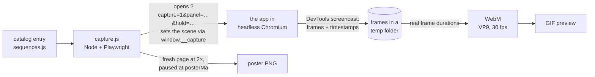

# Capturing clips and stills

Every moving picture in this repository was filmed from the running app: the asteroid's shock ring racing across the Cretaceous map, the tree of life unfurling from a single root to the living rim of today. Nothing is mocked up. A Node script opens the app in headless Chromium, steers it through a special *capture mode*, records the whole page and hands the frames to ffmpeg. When the app changes, one command films everything again, so the pictures keep up with the code.

This page is the overview. The full reference (every flag, catalog field, `window.__capture` method and error message) sits next to the scripts in [scripts/capture/README.md](../scripts/capture/README.md).

## The short version

```bash
# One-time setup, in scripts/capture/
npm install                        # Playwright
npx playwright install chromium    # the browser it drives (npm install does not fetch it)
brew install ffmpeg                # or: sudo apt install ffmpeg (needed for clips only)

# Each run: serve the project root in one shell…
python3 -m http.server 8080

# …and film from scripts/capture/ in another
node capture.js --list                         # what can be filmed
node capture.js kpg                            # one clip
node capture.js --all --out=/tmp/ltb-preview   # everything, written under /tmp/ltb-preview/assets/
node capture.js --all                          # everything, written into the project's assets/
```

Clips are recorded in real time. A full `--all` run (twelve clips with their posters, five species-dialog stills and seven interface stills) took under five minutes on a recent laptop. `--out=` is the safe way to preview, because nothing in the project is touched.

## What it produces

| Kind | Listed in `sequences.js` as | Files | Format |
|---|---|---|---|
| Clip | `sequences` | `assets/animations/NN-<id>.webm` | VP9 WebM, 30 fps |
| | | `assets/animations/NN-<id>.gif` | 480 px wide, 12 fps preview |
| | | `assets/screenshots/NN-<id>.png` | poster still at 2× pixel density |
| Species dialog | `modalShowcases` | `assets/screenshots/modal-<id>.png` | still at 2×, dialog open |
| Interface still | `stills` | the entry's `out`, e.g. `assets/life-tree-bloom.png` (the README hero) or `assets/screenshots/ui-<id>.png` | still at 2× |

`NN` is the entry's `order`. Clips, posters and dialog stills show the page in capture mode, without toolbar or timeline. Interface stills show the app exactly as a visitor sees it. The README and the sequence pages embed each WebM in a `<video>` element with its GIF as the fallback.

## How a clip is filmed



1. **Open.** A fresh page loads the app with `?capture=1`. Capture mode hides the toolbar, the timeline and the other controls. `panel` decides whether the sidebar and the context card stay on screen. `hold` sets how long the clock pauses on a mass extinction: 3.5 s in clips unless an entry says otherwise, against 6 s in the app.
2. **Wait for ready.** The script waits for the app's ready signal. If a module threw while booting, it fails at once and quotes the real error.
3. **Set the scene** through `window.__capture`: the view, speed, start time and layers. If the requested view doesn't come up (a globe that can't start, say), the clip fails instead of quietly filming the flat map.
4. **Record** the whole page through the DevTools screencast. That means the canvas *and* the page around and over it: context card, milestone toasts, the extinction card and the sidebar.
5. **Play.** The clock runs from `startMa` in real time. A mass extinction on the way is staged exactly as a viewer sees it: the hold, the slow crawl through the event, the aftermath fading out. The page pauses on the frame that reaches `endMa`, or on the frame where a still-fading aftermath ends. Time-lapse entries (`sweep`) glide evenly across their whole span instead. They step over extinction windows so the crisis card can't flash up for a single frame.
6. **Encode.** After a short linger on the last frame, ffmpeg turns the frames into a constant-frame-rate WebM using each frame's real timestamp, then makes the GIF. A clip therefore runs at the pace the scene actually played.
7. **Poster.** A second, fresh page at 2× pixel density sets the same scene at `posterMa`, paused, and takes the PNG.

## Capture mode

Capture mode is part of the app ([js/capture.js](../js/capture.js)) and is switched on by `?capture=1`:

| URL parameter | Effect |
|---|---|
| `capture=1` | Hide the controls and expose `window.__capture`. |
| `panel=clean` (default) | Show only the visualization and its story overlays: milestone toasts, era title cards, the extinction card. |
| `panel=sidebar` | … plus the life & planet sidebar, as a column on the right. |
| `panel=clock` | … plus the context card: period, age and the 24-hour Earth clock. |
| `panel=full` | … plus both. |
| `hold=<seconds>` | Set the length of the mass-extinction hold (`0` turns it off). |

The usual deep-link parameters (`t`, `view`, `plates`, `labels`, `speed`, `play`) work in capture mode too, and the URL is never rewritten. Capture mode is just as handy by hand. Open `http://localhost:8080/?capture=1&panel=full` and type into the DevTools console:

```js
__capture.setTime(70)
await __capture.playUntil(61.5)    // through the K-Pg impact; pauses once its aftermath has faded
```

## Honest by default

The pipeline would rather fail loudly than write a misleading picture. A capture fails, and its file is not written, when:

- the app throws while booting or during the capture;
- the requested view does not come up;
- a clip stops short of `endMa` because it hit its time cap (`maxSec`) or something paused playback;
- a species dialog does not open;
- an interface still that asks for an extinction hold never gets one.

Some problems are only warnings, marked with ⚠:

- a shot, or the end of a clip, lands inside a mass-extinction window, where the crisis card and vignette would cover the scene (a poster the entry marks `posterInEvent` is exempt);
- a GIF conversion fails.

With `--strict` (or `STRICT=1`), warnings and the page's console errors become failures too, and the run stops at the first one.

The exit code is `0` when everything was captured and `1` when anything failed (including a missing server or ffmpeg). It is `2` for a mistyped command, in which case nothing runs.

## The catalog today

`node capture.js --list` prints the live catalog. At the time of writing it holds these clips:

<!-- REVIEW after geometry lands -->
| # | id | Title | View | Ma | How it moves |
|---|---|---|---|---|---|
| 01 | `hadean` | Earth's Origin & Hadean | map | 4540 → 4000 | plays at 1.5× |
| 02 | `goe` | Great Oxidation Event | map | 2500 → 2200 | plays at 1× |
| 03 | `snowball` | Snowball Earth | globe | 730 → 632 | plays at 1× |
| 04 | `cambrian` | Cambrian Explosion | map | 540 → 486 | plays at 2× |
| 05 | `forests` | First Forests (Devonian) | map | 410 → 374.5 | plays at 1.5×, stopping short of the Late Devonian extinction |
| 06 | `permian` | End-Permian "Great Dying" | map | 262 → 241 | plays at 1× through the end-Permian extinction |
| 07 | `jurassic` | Jurassic Dinosaurs | globe | 198 → 146 | plays at 2× with plate boundaries shown |
| 08 | `kpg` | K-Pg Asteroid Impact | map | 70 → 61.5 | plays at 1× through the end-Cretaceous impact, with a 4.5 s hold |
| 09 | `pleistocene` | Ice Age & Megafauna | map | 2.58 → 0.014 | plays at 2.5× |
| 10 | `hominin` | Hominin Emergence | map | 6 → 0 | plays at 4× |
| 11 | `tree` | The Tree Blooms | tree | 4540 → 0 | 14 s time-lapse of the whole story |
| 12 | `drift` | Pangaea to Present | globe | 300 → 0 | 12 s time-lapse of the drifting continents |

The catalog also holds five species-dialog showcases: trilobites (500 Ma), *Tiktaalik* (375 Ma), *Tyrannosaurus rex* (67 Ma), and the woolly mammoth and *Homo sapiens* (both 50,000 years ago).

<!-- REVIEW after geometry lands -->
There are also seven interface stills:

- the README hero, the Cretaceous map at 95 Ma;
- the intro card a first-time visitor sees;
- the Late Jurassic globe with plate boundaries;
- the tree of life at the present;
- the end-Permian extinction card in the middle of its hold;
- the present-day map;
- a phone-sized view of the Carboniferous.

What each clip shows, and why it matters, is in [notable-sequences.md](notable-sequences.md).

## The smoke test

[`smoke-test.js`](../scripts/capture/smoke-test.js) sits beside the pipeline and answers a different question: *does the app still work?* It drives the real interface and capture mode in Chromium and checks contracts rather than internals. Those contracts include:

- the stable element ids;
- ARIA roles and states;
- deep links;
- the capture API;
- view switching and the mass-extinction staging;
- keyboard shortcuts;
- reduced motion;
- the data validator.

It also measures frame times, for information only.

```bash
cd scripts/capture
node smoke-test.js                       # every check, in about a minute
node smoke-test.js --only=boot,views     # some groups or check ids
node smoke-test.js --list                # the list of checks
```

It exits `0` when nothing failed and `1` when a check failed or the app isn't being served. It exits `2` for bad usage. Every failure prints what was expected, what was found and a screenshot path.

## When something goes wrong

<!-- REVIEW after geometry lands -->
| You see | Do this |
|---|---|
| `Dev server not reachable at http://localhost:8080` | Serve the project root (`python3 -m http.server 8080`) or pass `--base-url=`. |
| `ffmpeg is needed to encode clips (also with --no-gif)` | Install ffmpeg. Species-dialog and interface stills don't need it. |
| `browserType.launch: Executable doesn't exist` | Run `npx playwright install chromium` in `scripts/capture/`. |
| `the globe view did not come up` | The globe needs WebGL and loads three.js from `cdn.jsdelivr.net`. Check the network. |
| `stopped at … Ma, before reaching … Ma: hit the 30 s cap (maxSec)` | The scene plays longer than its cap. Raise the entry's `maxSec` or `speed`. |
| `⚠ … Ma is inside the … window, so the shot shows its crisis look` | Move the time a few million years clear of the event, or mark a poster `posterInEvent` if it is meant to show it. |

The reference has the [full troubleshooting list](../scripts/capture/README.md#troubleshooting).

## Where things live

| File | What it is |
|---|---|
| [scripts/capture/capture.js](../scripts/capture/capture.js) | the pipeline's command line |
| [scripts/capture/sequences.js](../scripts/capture/sequences.js) | the catalog: clips, species-dialog showcases, interface stills |
| [scripts/capture/smoke-test.js](../scripts/capture/smoke-test.js) | the end-to-end smoke test |
| [js/capture.js](../js/capture.js) | capture mode inside the app (`window.__capture`) |
| [css/styles.css](../css/styles.css) | what capture mode hides (component stylesheets add a few rules of their own) |
